# Лабораторная работа № 4. Тестирование динамических сайтов

| Задача | Сайт | Файл с тестами |
|---|---|---|
| 1 | https://old.vyatsu.ru | `OldVyatsuTest.java` |
| 2 | https://otzovik.com | `OtzovikTest.java` |
| 3 | https://m.cdsvyatka.com/ | `CdsVyatkaTest.java` |

---

## Задача 1

**Задача 1.** На сайте https://old.vyatsu.ru выполните следующие сценарии.

### Сценарий 1

> Откройте меню Сведения об образовательной организации, выберите пункт Образовательные стандарты. Перейдите на эту эту страницу. Убедитесь, что отображается верная страница.

**Тест:** `OldVyatsuTest.oldvyatsu_scenario1`

**Проверка в тесте:** заголовок страницы содержит «Образовательные стандарты».

**Шаги и подтверждение работы:**

1. Открыто меню, виден пункт «Образовательные стандарты».

   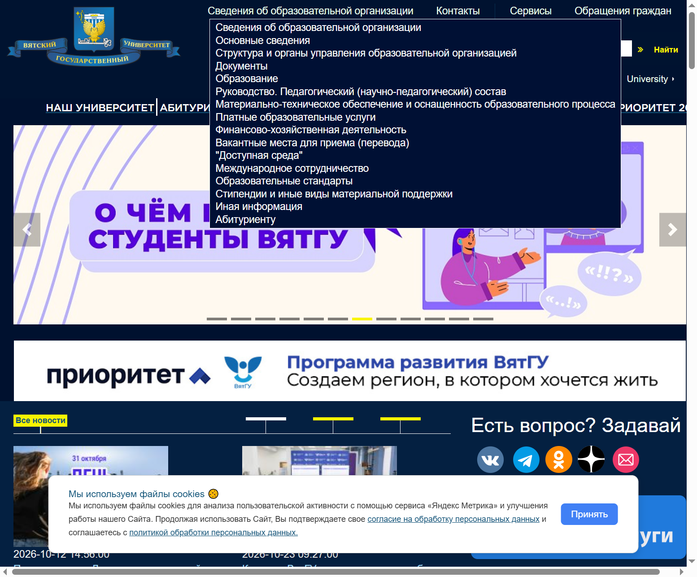

2. Выполнен переход, открыта страница «Образовательные стандарты».

   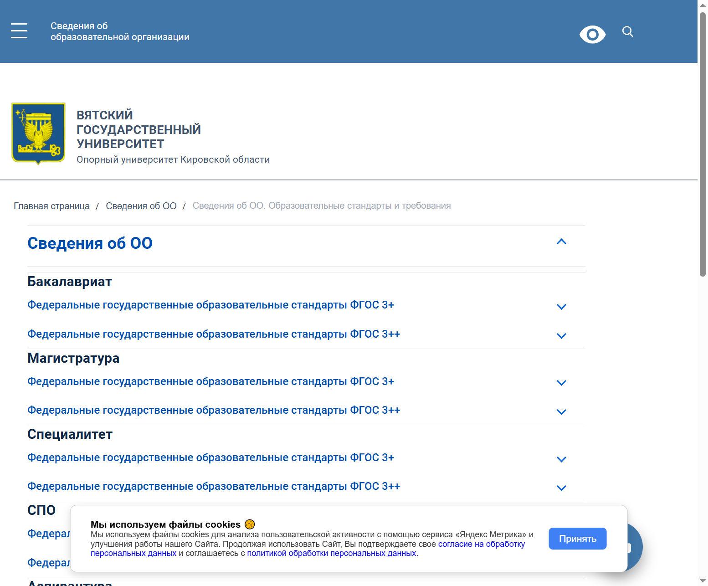

**Результат:** Тест выполнен успешно.

### Сценарий 2

> Получите результаты поиска по слову отпуск со страницы. Убедитесь, что результат поиска не пустой.

**Тест:** `OldVyatsuTest.oldvyatsu_scenario2_search`

**Проверка в тесте:** список результатов поиска не пустой.

**Шаги и подтверждение работы:**

1. В строку поиска введено слово «отпуск».

   

2. Открыта страница с результатами поиска.

   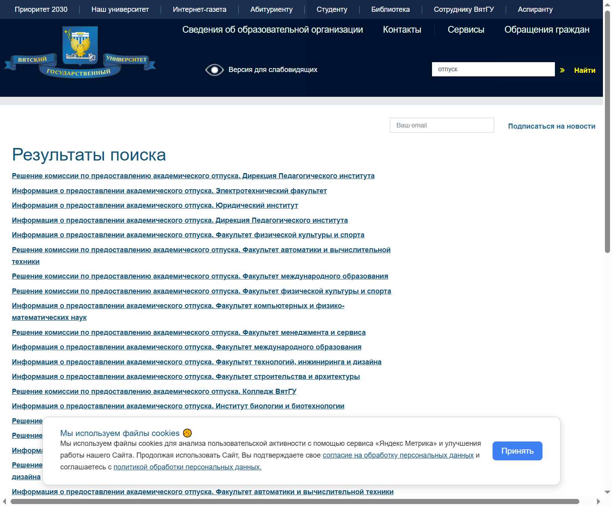

**Результат:** найдено результатов: 47. Тест пройден успешно.

### Сценарий 3

> Перейдите на страницу Студенту. Выполните подписку на новости. Определите результат подписки в случае корректного и некорректного e-mail.

Уведомление о результате подписки появляется в виде диалогового окна браузера (alert), на скриншот оно не попадает.
Его текст выводится в консоль и проверяется в тесте.

#### Некорректный e-mail

**Тест:** `OldVyatsuTest.oldvyatsu_scenario3_mail_invalid`

**Введённый e-mail:** `@vgmale.com`

**Проверка в тесте:** текст уведомления содержит «Неправильно введен e-mail».

1. Открыта страница «Студенту».

   

2. В поле введён некорректный e-mail.

   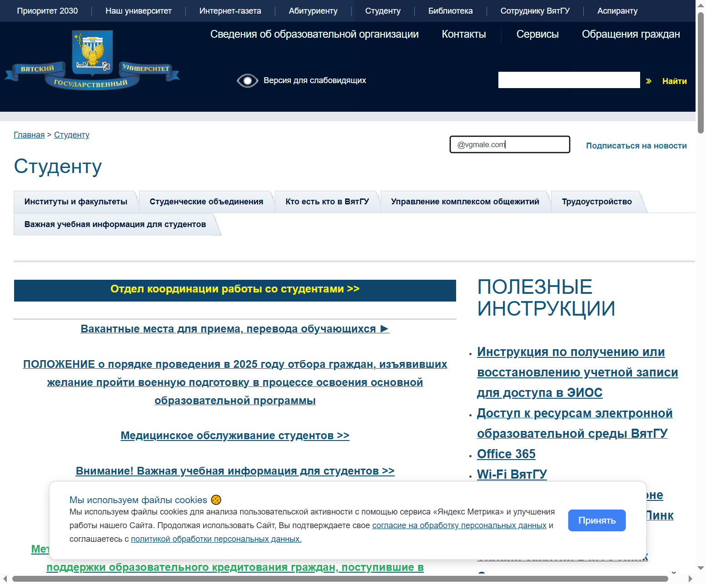

3. Уведомление закрыто.

   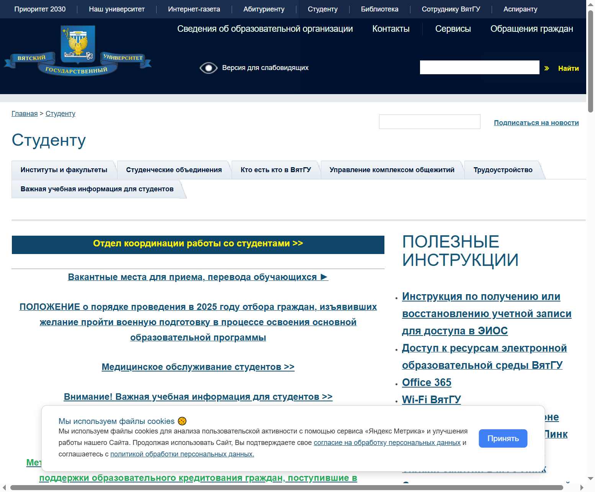

**Результат подписки (текст уведомления):** Неправильно введен e-mail.

#### Корректный e-mail

**Тест:** `OldVyatsuTest.oldvyatsu_scenario3_mail_valid`

**Введённый e-mail:** случайное четырёхзначное число и `@vgmale.com`, например: 1234@vgmail.com

**Проверка в тесте:** текст уведомления содержит «успешно добавлен в список рассылки новостей».

1. Открыта страница «Студенту».

   

2. В поле введён корректный e-mail.

   

3. Уведомление закрыто.

   

**Результат подписки (текст уведомления):** Ваш адрес e-mail "3207@vgmale.com" успешно добавлен в список рассылки новостей

---

## Задача 2

**Задача 2.** На сайте https://otzovik.com выполните следующие сценарии.

### Сценарий 1

> В поисковой строке введите "яндекс". В выпадающем списке выберите "Yandex Metro - программа для Android". Убедитесь, что открылась нужная страница, количество отзывов не пусто.

**Тест:** `OtzovikTest.TestOtzovikScenario1`

**Проверка в тесте:** адрес страницы содержит `yandex_metro`, количество отзывов найдено и больше нуля.

**Шаги и подтверждение работы:**

1. В поисковой строке введено «яндекс», в выпадающем списке виден пункт «Yandex Metro - программа для Android».

   

2. Открыта страница «Yandex Metro - программа для Android», отображается количество отзывов.

   

**Результат:** найдено отзывов: 55

### Сценарий 2

> Нажмите на кнопку "Написать отзыв". В поле введите точное название. Выберите ботанический сад в Кирове. Заполните часть обязательных полей, нажмите предпросмотр. Убедитесь, что открылось диалоговое окно с ошибками.

**Тест:** `OtzovikTest.TestOtzovikScenario2`

**Введённое название:** «Ботанический сад ВятГУ»

**Проверка в тесте:** диалоговое окно с ошибками отображается.

**Шаги и подтверждение работы:**

1. В поле введено название, в списке виден «Ботанический сад ВятГУ (Россия, Киров)».

   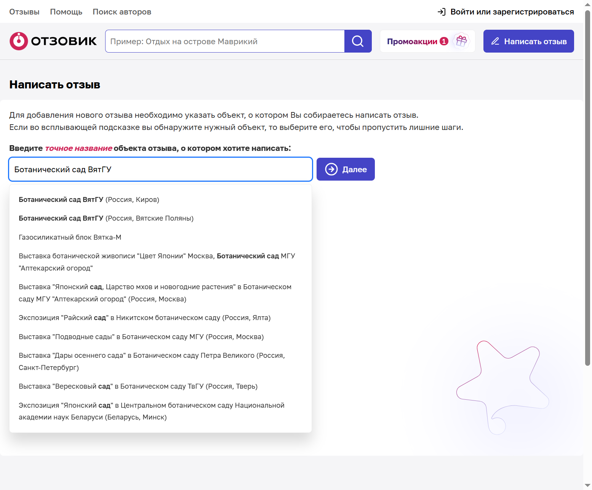

2. Открыта форма отзыва.

   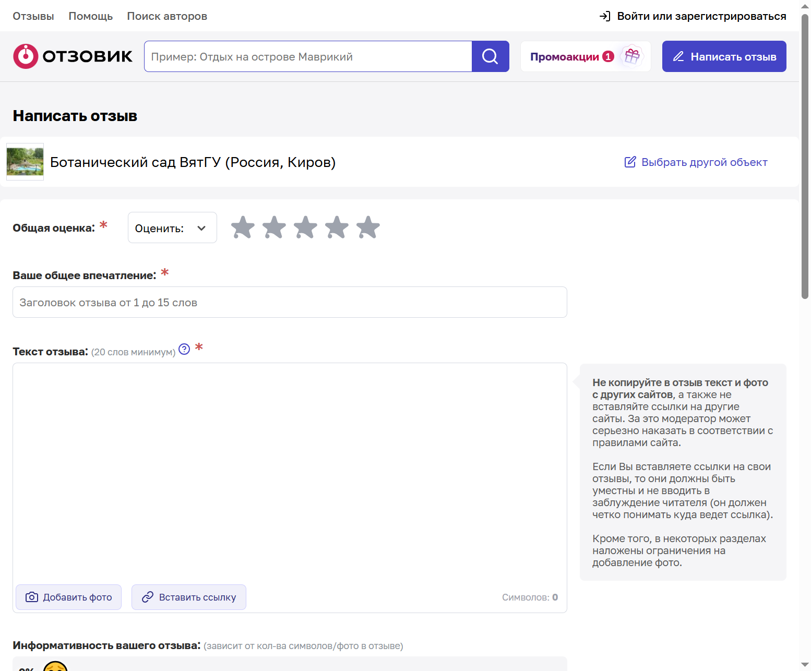

3. Заполнена часть полей формы.

   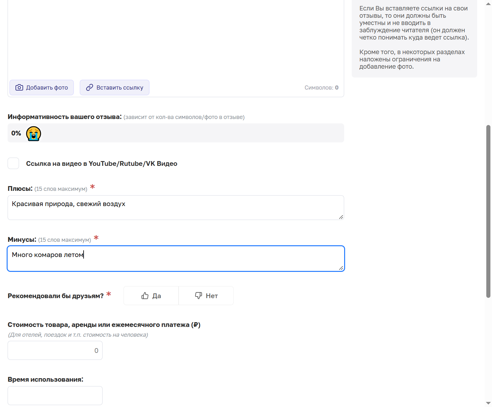

4. После нажатия «Предпросмотр» открыто диалоговое окно с ошибками.

   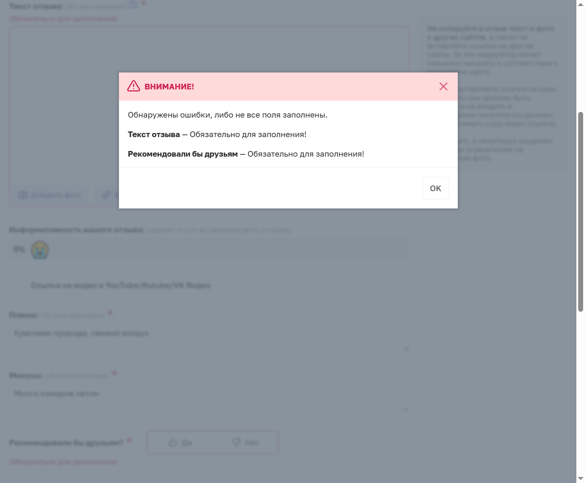

**Результат:** Тест пройден успешно, диалоговое окно показывается после хотя бы одного пустого обязательного поля.

---

## Задача 3

**Задача 3.** На сайте https://m.cdsvyatka.com/ выполните следующие сценарии.

### Сценарий 1

> Выберите населенный пункт и маршрут. Покажите выбранный маршрут на карте. Для выбранного маршрута получите характеристики какого-то автобуса (рис. 1). Убедитесь, что характеристики автобуса отображаются.

**Тест:** `CdsVyatkaTest.cdsvyatka_scenario1_bus_info`

**Выбранные значения:** населённый пункт — Киров, маршрут — «Авт 3: Железнодорожный вокзал-Силикатный завод».

**Проверка в тесте:** на карте есть остановки маршрута, в окне автобуса есть «Автобус по маршруту», «№: 3» и «Гос. номер».

**Шаги и подтверждение работы:**

1. Выбраны населённый пункт и маршрут.

   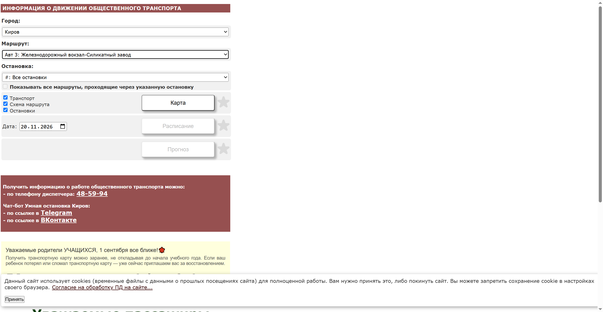

2. Маршрут показан на карте.

   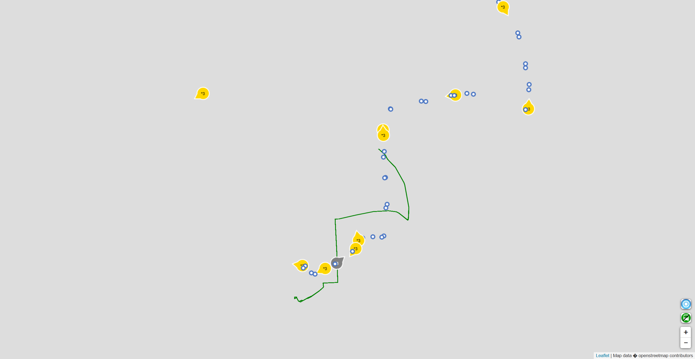

3. Отображаются характеристики автобуса.

   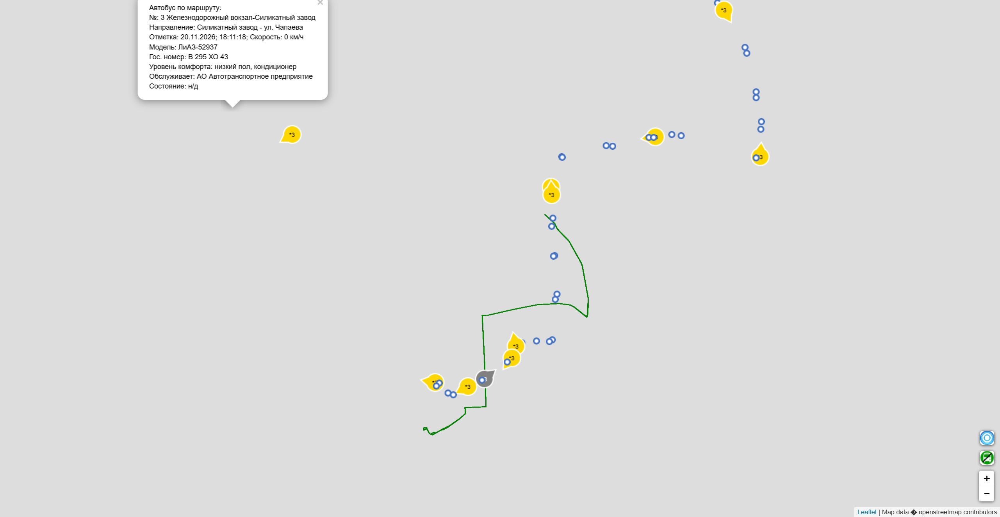

**Результат:** Тест пройден успешно. Информация об автобусе открывается.

### Сценарий 2

> Выберите населенный пункт, маршрут и остановку. Получите прогноз. Убедитесь, что открылась нужная страница, на которой можно определить время ожидания и номер автобуса.

**Тест:** `CdsVyatkaTest.cdsvyatka_scenario2_prediction`

**Выбранные значения:** населённый пункт — Киров, маршрут — «Авт 3: Железнодорожный вокзал-Силикатный завод», остановка — «Вятский торговый дом» (код 457).

**Проверка в тесте:** заголовок страницы содержит «Прогноз по остановке», заголовок остановки содержит код 457, в таблице прогноза определено время ожидания и гос. номер автобуса.

**Шаги и подтверждение работы:**

1. Выбраны населённый пункт, маршрут и остановка.

   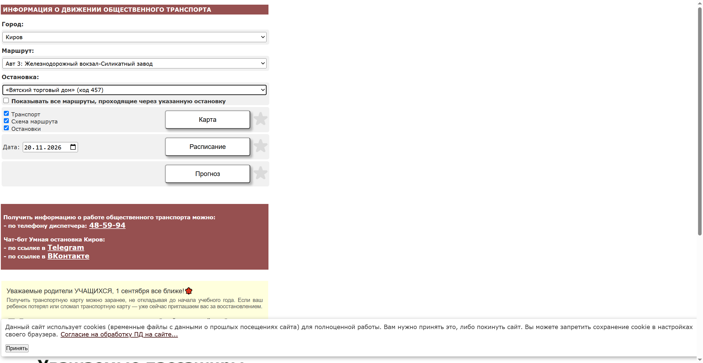

2. Открыта страница прогноза по остановке.

   

**Результат:** Тест пройден успешно, прогноз показывает верно: маршрут А3 авт., время ожидания  0.9 мин., гос. номер автобуса Е 755 РХ 43.

---

## Падение тестов и решение ошибок

**Otzovik, сценарий 1**
При прохождений теста Selenium застревал на экране отзывов по поиску, а затем выходил из теста с ошибкой.

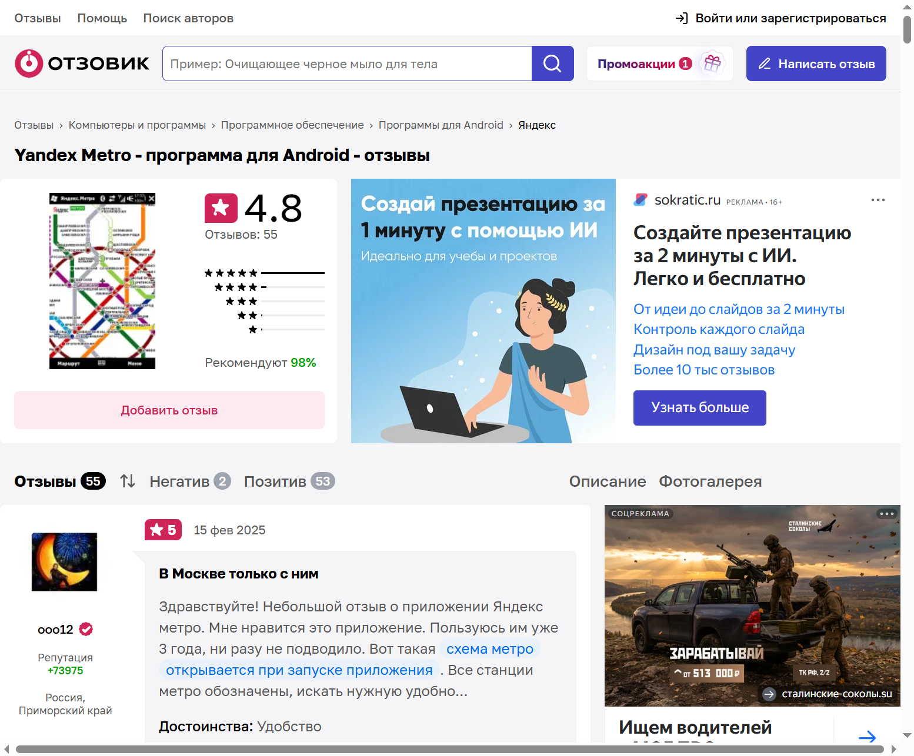

Ошибка при которой падал тест:
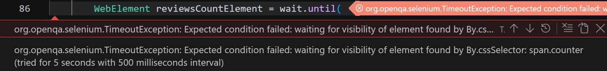

Проблема заключалась в неточном определений селектора количества отзывов, selenium не видел элемент по By.cssSelector("span.counter"). 
В качестве решения было написание более подробного селектора: (a.reviews.tab.active span.counter)

---

Дальнейшее тестирование прошло успешно, пару раз были ошибки в селекторах.
Ситуации, когда тест написан полностью правильно, а сайт выдавал неправильный результат не обнаружилось.